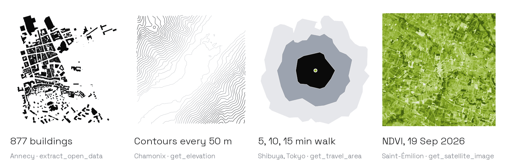

# TerraLab MCP

**Geodata for any place, inside your agent.** One hosted MCP server, used with your TerraLab account:

```
https://mcp.terra-lab.ai/mcp
```

Data about a place is spread across national portals, file formats and licences, where an agent cannot
reach it. TerraLab MCP gives any agent geodata for any place on Earth: map data, terrain, routes, satellite
images and French parcels, each with its source and licence, as files QGIS opens as they are. It is built
by TerraLab, whose QGIS plugins show every day what GIS users ask for.

<picture>
  <source media="(prefers-color-scheme: dark)" srcset="assets/readme-header-dark.png">
  
</picture>

| | |
| --- | --- |
| Server URL | `https://mcp.terra-lab.ai/mcp` |
| Transport | Streamable HTTP, hosted by TerraLab |
| Authentication | A TerraLab account: OAuth sign-in from your agent, or an API key for scripts; see [Account](#account) |
| Tools | 12, all read-only |
| Coverage | Worldwide; France in more depth (cadastre, PLU, IGN aerial photos and building heights) |

Made by [TerraLab](https://terra-lab.ai), which builds AI plugins for QGIS.

## Start in 30 seconds

Pick your agent. It is the same URL everywhere.

| Agent | Setup |
| --- | --- |
| **Claude Code** | `claude mcp add --transport http terralab https://mcp.terra-lab.ai/mcp` (add `--scope user` for every project) |
| **Claude.ai, Claude Desktop** | [Add a custom connector](https://claude.ai/customize/connectors?modal=add-custom-connector&connectorName=TerraLab&connectorUrl=https%3A%2F%2Fmcp.terra-lab.ai%2Fmcp) with the URL above (Settings, Connectors, Add) |
| **ChatGPT** | [Open TerraLab in the ChatGPT app directory](https://chatgpt.com/apps/terralab/asdk_app_6abeb2f16190819199cc1be0ed69e8d4) and add it, then type `@TerraLab` in a chat |
| **Cursor** | [Add to Cursor](https://cursor.com/en/install-mcp?name=terralab&config=eyJ1cmwiOiJodHRwczovL21jcC50ZXJyYS1sYWIuYWkvbWNwIn0=), or in `~/.cursor/mcp.json`: `{"mcpServers": {"terralab": {"url": "https://mcp.terra-lab.ai/mcp"}}}` |
| **VS Code (Copilot)** | [Install in VS Code](https://vscode.dev/redirect/mcp/install?name=terralab&config=%7B%22type%22%3A%22http%22%2C%22url%22%3A%22https%3A%2F%2Fmcp.terra-lab.ai%2Fmcp%22%7D), or `code --add-mcp '{"name":"terralab","type":"http","url":"https://mcp.terra-lab.ai/mcp"}'` |
| **Windsurf** | Cascade, `...`, Open MCP config file, then add `{"mcpServers": {"terralab": {"serverUrl": "https://mcp.terra-lab.ai/mcp"}}}` |
| **Gemini CLI** | `gemini extensions install https://github.com/TerraLabAI/mcp` (server plus skills), or `gemini mcp add --transport http terralab https://mcp.terra-lab.ai/mcp` |
| **Codex** | `codex mcp add terralab --url https://mcp.terra-lab.ai/mcp` |

The first time, your agent opens the TerraLab sign-in in your browser (in Claude Code run
`/mcp`, in Codex `codex mcp login terralab`). Then ask:

> Get the buildings within 500 m of Annecy old town as a Shapefile for QGIS.

Each line follows the client's own MCP documentation:
[Claude Code](https://code.claude.com/docs/en/mcp),
[Cursor](https://cursor.com/docs/mcp),
[VS Code](https://code.visualstudio.com/docs/agents/reference/mcp-configuration),
[Windsurf](https://docs.windsurf.com/windsurf/cascade/mcp),
[Gemini CLI](https://geminicli.com/docs/tools/mcp-server),
[Codex](https://developers.openai.com/codex/mcp).
In VS Code, run **MCP: Reset Cached Tools** after the server adds a tool.

## What you can ask

Twelve tools, named by what they do. Your agent picks the tool; most tools find the place
themselves, so a name or an address is enough.

| Do | Tool | Ask your agent |
| --- | --- | --- |
| **Extract** map layers | `extract_open_data` | "All pharmacies in Lyon as a CSV" |
| **Find** places and addresses | `find_places` | "Put these 40 customer addresses on a map and give me the CSV with coordinates" |
| **Read** elevation, profiles, contours | `get_elevation` | "Contour lines every 10 m and a slope map around Annecy old town" |
| **Route** between places | `get_route` | "Cycling route from Nantes to Saint-Nazaire as a GPX, avoiding highways" |
| **Reach** within a time | `get_travel_area` | "Everything within 10 and 20 minutes' drive of Bordeaux station" |
| **Measure** distances and areas | `measure` | "Area of this polygon in hectares, and a 500 m buffer around it" |
| **Process** a layer | `process_geometry` | "Clip these buildings to the commune boundary and dissolve them by type" |
| **See** from space | `get_satellite_image` | "Latest cloud-free NDVI of my vineyard near Saint-Émilion" |
| **Open** and convert a file | `open_gis_file` | "Turn this GPX track into a Shapefile" |
| **Convert** coordinates | `convert_coordinates` | "Convert X 942507, Y 6538034 in Lambert 93 to GPS, and which CRS should I use in QGIS?" |
| **Look up** a French parcel and its zone | `french_parcel` | "Which cadastral parcel and PLU zone is the town hall of Annecy on?" |
| **Measure** French building heights | `french_building_heights` | "How tall are the buildings within 150 m of Place Bellecour, Lyon?" |

`extract_open_data` layers: buildings, roads, addresses, administrative boundaries and
divisions, places, land use, points of interest (one `kind` such as pharmacies or schools),
waterways, water areas, power lines, railways, routes, transit stops and protected areas.

Every result has a short text answer for the model, structured content for code (`downloads`,
`sources` and the figures of each tool), an interactive map in clients that show one, and
download links that build the file when opened.

## Recipes

Five real requests, each with the exact call and the answer production returned on
2026-10-24. Paste the question into your agent, or send the call from code.

### 1. Buildings of a town centre, for QGIS

> Get the buildings within 500 m of Annecy old town as GeoJSON and Shapefile.

```json
{"name": "extract_open_data", "arguments": {"theme": "buildings", "area": {"place": "Annecy old town, France", "radius_m": 500}, "formats": ["geojson", "shapefile"]}}
```

Answer in 4.0 s: 877 buildings in about 1.00 km², centre 45.89923, 6.12888; most common type
`class=apartments` (288). Downloads: GeoPackage, GeoJSON, Shapefile (zip). Source: Overture Maps
release 2026-09-23, ODbL 1.0, © OpenStreetMap contributors, Overture Maps Foundation and the
other contributors the answer lists.

Check: buildings crossing the edge come back whole. One extract holds at most 20,000
features, so for a whole city ask for a smaller radius, or one `kind` of feature.

### 2. Parcel and zoning of a French address

> Which cadastral parcel and PLU zone is the town hall of Annecy on?

```json
{"name": "french_parcel", "arguments": {"address": "Place de l'Hôtel de Ville, 74000 Annecy"}}
```

Answer in 1.9 s: parcel 74010000BY0186, commune Annecy (INSEE 74010), section BY, number 0186,
cadastral area 1,038 m². PLU zone Uah (type U, historic centre), document
`200066793_PLUI_20260326`. Lambert 93: X 942507.90, Y 6538034.33. GeoJSON and KML of the
parcel. Sources: DGFiP cadastre (edition 2026-06-01), Géoportail de l'Urbanisme (2026-09-09),
IGN geocoder, all Licence Ouverte 2.0.

Check: the address matched "Esplanade de l'Hôtel de Ville"; confirm the match is the place
you meant. The cadastral plan does not fix property boundaries, and the tool never returns
owners or sale prices.

### 3. Terrain of a mountain site

> Contour lines every 50 m, a DEM, hillshade and slope within 2 km of Chamonix.

```json
{"name": "get_elevation", "arguments": {"mode": "area", "area": {"place": "Chamonix-Mont-Blanc, France", "radius_m": 2000}, "interval_m": 50}}
```

Answer in 3.2 s: 26 contour levels over about 16.0 km², from 1,011 m to 2,357 m; mean slope
46.4 %, 80 % of the area steeper than 10 %. Downloads: DEM, hillshade and slope GeoTIFFs,
contours as GeoJSON, KML and Shapefile. Source: Copernicus DEM GLO-30.

Check: Copernicus DEM is a 30 m surface model, so it includes buildings and trees. Use it for
terrain, not for the height of a single building.

### 4. Walking catchment of a station, anywhere

> What can I reach on foot in 5, 10 and 15 minutes from Shibuya Station?

```json
{"name": "get_travel_area", "arguments": {"starts": ["Shibuya Station, Tokyo"], "minutes": [5, 10, 15], "mode": "walking"}}
```

Answer in 2.5 s: 3 polygons with fields `start`, `minutes` and `mode`, from Shibuya Station
(35.65972, 139.69959). Their areas, measured from the GeoJSON: about 0.44, 1.71 and 3.78 km².
Downloads: GeoJSON, KML, Shapefile, GeoPackage. Sources: Valhalla routing on the OpenStreetMap
road network and the TerraLab geocoder, ODbL 1.0.

Check: the answer names the start it used. A station name can match a freight yard or a shop
inside the station; when the name differs from what you meant, pass `{latitude, longitude}`.

### 5. Vegetation of a vineyard from Sentinel-2

> Latest cloud-free NDVI within 2 km of Saint-Émilion.

```json
{"name": "get_satellite_image", "arguments": {"area": {"place": "Saint-Émilion, France", "radius_m": 2000}, "source": "sentinel2", "product": "ndvi"}}
```

Answer in 2.7 s: scene `S2C_30TYQ_20260919_0_L2A` of 2026-09-19, 0 % cloud, the least cloudy
of 7 scenes from the last 60 days. NDVI GeoTIFF, 10 m, 415 × 415 px (about 0.7 MB), in
EPSG:32630 (UTM 30N), licence and date in the file. Source: Copernicus Sentinel-2 L2A.

Check: cloud, shadow and snow pixels are NaN, not zero. Inside metropolitan France, true colour
without a date defaults to the IGN aerial photo (0.5 to 1 m) instead of Sentinel-2.

More chained workflows are in [`examples/`](examples/), such as a site pack that writes a
folder of GIS files for any place.

## Skills

Skills tell your agent which tool fits a request and how to report the result. They need the
server above; installing a skill alone does not connect it.

| Skill | When your agent uses it |
| --- | --- |
| [`use-terralab`](skills/use-terralab/SKILL.md) | Any request about a real place or a GIS file: routes it to the right tool, resolves the place honestly, reports figures, files, sources and licences |
| [`map-data-for-a-place`](skills/map-data-for-a-place/SKILL.md) | Boundaries, buildings, roads, transit, addresses, POIs, land use, water, power lines or protected areas as files for QGIS |
| [`terrain-and-elevation`](skills/terrain-and-elevation/SKILL.md) | Altitude, profiles along a route, contour lines and slope |
| [`site-study`](skills/site-study/SKILL.md) | A first look at a site before a project; in France, parcel and PLU zone |
| [`places-files-and-coordinates`](skills/places-files-and-coordinates/SKILL.md) | Addresses and GIS files on a map, file conversion, coordinates and CRS choice |

Install them:

```text
/plugin marketplace add TerraLabAI/mcp
/plugin install terralab@terralab-ai-apps
```

In Claude Code, the plugin adds the server and the five skills. For other agents (Cursor,
Codex, Windsurf, OpenCode, Gemini CLI and others), use the [skills CLI](https://skills.sh/terralabai/mcp):

```bash
npx skills add TerraLabAI/mcp
```

Or copy one `SKILL.md` into your agent's skills folder, for example
`~/.claude/skills/use-terralab/SKILL.md`. The Gemini CLI extension carries the skills'
routing in [`GEMINI.md`](GEMINI.md).

## Use it from code

The server speaks MCP over Streamable HTTP, so any MCP client library works. From code,
send `Authorization: Bearer <TerraLab API key>` with each request (see [Account](#account)).
The runnable versions, with the date each one was last run, are in [`examples/`](examples/).

**Python, official MCP SDK** (`pip install "mcp>=2.3"`)

```python
import asyncio
from mcp import Client

async def main():
    async with Client("https://mcp.terra-lab.ai/mcp") as client:
        result = await client.call_tool(
            "extract_open_data",
            {"theme": "buildings", "area": {"place": "Kreuzberg, Berlin", "radius_m": 300}},
        )
        print(result.content[0].text)
        for d in result.structured_content["downloads"]:
            print(d["format"], d["url"])

asyncio.run(main())
```

**TypeScript, official MCP SDK** (`npm i @modelcontextprotocol/sdk`)

```ts
import { Client } from "@modelcontextprotocol/sdk/client/index.js";
import { StreamableHTTPClientTransport } from "@modelcontextprotocol/sdk/client/streamableHttp.js";

const client = new Client({ name: "my-agent", version: "1.0.0" });
await client.connect(new StreamableHTTPClientTransport(new URL("https://mcp.terra-lab.ai/mcp")));
const result = await client.callTool({
  name: "get_elevation",
  arguments: { mode: "point", points: ["Mont Blanc summit"] },
});
console.log(result.content[0].text);
```

<details>
<summary>OpenAI, Anthropic, LangGraph, Vercel AI SDK, Google ADK and others</summary>

**OpenAI Agents SDK** (`pip install openai-agents`)

```python
from agents import Agent, Runner
from agents.mcp import MCPServerStreamableHttp

async with MCPServerStreamableHttp(
    name="terralab", params={"url": "https://mcp.terra-lab.ai/mcp", "timeout": 120},
    client_session_timeout_seconds=300,
) as terralab:
    agent = Agent(name="GIS assistant", mcp_servers=[terralab])
    print((await Runner.run(agent, "Roads of Nairobi CBD as GeoJSON")).final_output)
```

**OpenAI Responses API** (OpenAI calls the server for you)

```python
from openai import OpenAI

response = OpenAI().responses.create(
    model="gpt-5.5",
    tools=[{
        "type": "mcp",
        "server_label": "terralab",
        "server_url": "https://mcp.terra-lab.ai/mcp",
        "require_approval": "never",
    }],
    input="Contour lines every 10 m around Annecy old town, as GeoJSON.",
)
print(response.output_text)
```

**Anthropic Messages API, MCP connector**

```python
import anthropic

response = anthropic.Anthropic().beta.messages.create(
    model="claude-opus-5-5",
    max_tokens=2000,
    betas=["mcp-client-2025-11-20"],
    mcp_servers=[{"type": "url", "url": "https://mcp.terra-lab.ai/mcp", "name": "terralab"}],
    tools=[{"type": "mcp_toolset", "mcp_server_name": "terralab"}],
    messages=[{"role": "user", "content": "Which cadastral parcel is at 12 rue de la Paix, Annecy?"}],
)
```

**LangChain / LangGraph** (`pip install langchain-mcp-adapters langchain`)

```python
from langchain.agents import create_agent
from langchain_mcp_adapters.client import MultiServerMCPClient

client = MultiServerMCPClient(
    {"terralab": {"url": "https://mcp.terra-lab.ai/mcp", "transport": "streamable_http"}}
)
tools = await client.get_tools()
agent = create_agent("openai:gpt-5.5", tools)
```

**Vercel AI SDK** (`npm i ai @ai-sdk/mcp`)

```ts
import { createMCPClient } from "@ai-sdk/mcp";

const terralab = await createMCPClient({
  transport: { type: "http", url: "https://mcp.terra-lab.ai/mcp" },
});
const tools = await terralab.tools(); // pass to generateText / streamText
```

**Google ADK** (`pip install "google-adk[mcp]"`; without the `mcp` extra, `McpToolset` does not import)

```python
from google.adk.agents import LlmAgent
from google.adk.tools.mcp_tool import McpToolset
from google.adk.tools.mcp_tool.mcp_session_manager import StreamableHTTPConnectionParams

root_agent = LlmAgent(
    model="gemini-flash-latest", name="gis_assistant",
    tools=[McpToolset(connection_params=StreamableHTTPConnectionParams(
        url="https://mcp.terra-lab.ai/mcp", timeout=120))],
)
```

Other frameworks take the same URL as a Streamable HTTP server: CrewAI
(`mcps=["https://mcp.terra-lab.ai/mcp"]`), Pydantic AI (`MCPToolset(url)`), LlamaIndex
(`BasicMCPClient(url)`), Mastra (`MCPClient` with `url: new URL(...)`), smolagents
(`MCPClient({"url": ..., "transport": "streamable-http"})`). We have not run these five yet.

</details>

Large areas take time: give your MCP client a timeout of at least 120 seconds. Download links
serve gzip when you send `Accept-Encoding: gzip` (httpx and requests do it for you).

## Sources and licences

Every answer names its sources and licences, and every downloaded file carries its licence.

| Data | Source | Licence |
| --- | --- | --- |
| Map layers (buildings, roads, land use, water, POIs...) | OpenStreetMap and Overture Maps | ODbL 1.0 and the licences each layer lists |
| Geocoding | TerraLab geocoder (Photon, OpenStreetMap); in France, IGN Géoplateforme (Base Adresse Nationale) | ODbL 1.0; Licence Ouverte 2.0 |
| Routes and travel areas | Valhalla on the TerraLab server, OpenStreetMap road network | ODbL 1.0 |
| Elevation, contours, slope | Copernicus DEM GLO-30 | Copernicus DEM licence |
| Satellite images | Copernicus Sentinel-2 L2A; in France, IGN orthophotos | Copernicus Sentinel data terms; Licence Ouverte 2.0 |
| French parcels and zoning | DGFiP cadastre, Géoportail de l'Urbanisme | Licence Ouverte 2.0 |
| French building heights | IGN BD TOPO | Licence Ouverte 2.0 |

Results are approximate and not for navigation, surveying or legal boundaries.

## Public contract

- All tools are read-only.
- Changes are additive: tools and optional parameters are added; a tool, a parameter or an
  output field is never removed or renamed, and an optional parameter never becomes
  required, without 30 days' notice on [terra-lab.ai/mcp](https://terra-lab.ai/mcp).
- Names, attributes and file contents in results come from third parties; the server tells
  agents to treat them as data, never as instructions.

## Privacy

TerraLab receives only what a request needs (place names, addresses, coordinates, areas and
files) and logs each call's tool, status and duration, without your query, file or IP
address. Files you send are processed in memory and not kept; download files are not
stored, each link rebuilds its file when opened. Usage identifiers are keyed hashes kept in
West Europe and deleted within 35 days. Full text:
[privacy policy, AI assistants](https://terra-lab.ai/privacy-policy#ai-assistants).

## Account

TerraLab needs a TerraLab account.

- **In an agent**: the first call opens the TerraLab sign-in in your browser (OAuth). Approve
  the access once; your agent keeps the connection.
- **From code**: create an API key in your TerraLab dashboard
  ([terra-lab.ai/dashboard/agent-access](https://terra-lab.ai/dashboard/agent-access)) and send
  it as `Authorization: Bearer <key>`. Keep it in an environment variable, never in a commit.

Each account has a daily number of data calls; a call past it returns a `daily_limit` error
that resets at 00:00 UTC.

## Links

- Setup page for every agent: https://terra-lab.ai/mcp
- Terms of use: https://terra-lab.ai/terms-of-use
- Privacy policy: https://terra-lab.ai/privacy-policy#ai-assistants
- Support: https://terra-lab.ai/support or yvann.barbot@terra-lab.ai

This repository holds the plugin packages (Claude, Cursor, Gemini CLI), the skills and the
examples. The server itself is hosted by TerraLab and is not in this repository. The Claude
marketplace ID stays `terralab-ai-apps` so existing install commands keep working.

TerraLab also makes AI plugins for QGIS: AI Segmentation, AI Edit and AI Agent.
